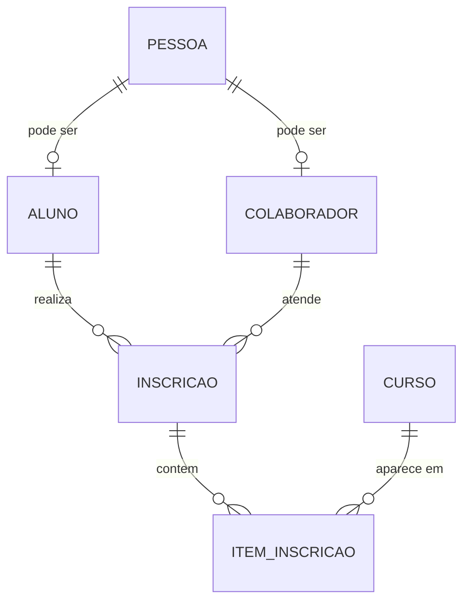

# Tema do projeto

## Identificação

- Nome do projeto: LearnTech
- Tema: gerenciamento de cursos de uma plataforma de ensino
- Objetivo em uma frase: cadastrar cursos e organizá-los por categoria

## Entidade de classificação

- Nome no singular: CategoriaCurso
- Nome no plural: CategoriasCurso
- Exemplo 1: Programação básica.
- Exemplo 2: Desenvolvimento Web

## Entidade principal

- Nome no singular: Curso
- Nome no plural: Cursos
- Código único: id
- Descrição: nome do curso
- Medida quantitativa: carga horária
- Valor monetário: preço
- Data relevante: data de cadastro
- Status: ativo ou inativo

## Relacionamento

- Uma categoria pode possuir vários cursos.
- Cada curso pertence a uma categoria.

## Três exemplos de registros

1. Curso: C# e .NET para Iniciantes — Categoria: Programação básica — Código: 01 — Carga horária: 40 horas — Preço: R$ 149,90 — Status: ativo
2. Curso: Desenvolvimento de APIs REST com ASP.NET Core — Categoria: Desenvolvimento Web — Código: CURSO002 — Carga horária: 30 horas — Preço: R$ 129,90 — Status: ativo
3. Curso: Banco de Dados com SQL — Categoria: Banco de Dados — Código: CURSO003 — Carga horária: 25 horas — Preço: R$ 99,90 — Status: ativo

| **Elemento do Suporte OS** | **Elemento do meu tema** | **Regra correspondente** |
|---|-------------------------|---|
| `GrupoProduto` | `CategoriaCurso`        | classifica a entidade principal |
| `Produto` | `Curso`                 | entidade principal |
| `codigoBarras` | `codigoCurso`           | identificação única de negócio |
| `descricao` | `descricao`             | descrição compreensível |
| `saldoEstoque` | `cargaHoraria`          | medida quantitativa |
| `valorUnitario` | `valorCurso`            | valor monetário |
| `dataCadastro` | `dataCadastro`          | data relevante |
| `Status` | `Status`                | estados válidos |
| `calcularValorEstoque` | `calcularValorPorHora` | cálculo que combina carga horária e valor do curso |

## Justificativa dos métodos e códigos HTTP (Aula 08)

- **PUT** substitui a representação editável do recurso e é idempotente: enviar o mesmo corpo duas vezes deixa o curso no mesmo estado. Por isso é usado para alterar categoria, curso e status.
- **POST** nas rotas de carga horária (`/acrescimos` e `/reducoes`) registra um evento. Repetir a requisição soma de novo, então a operação não é idempotente.
- **DELETE** remove fisicamente o registro e devolve `204` sem corpo. Uma categoria com cursos não pode ser excluída, apenas inativada.
- **400 Bad Request**: dados inválidos ou regra de domínio violada (campo em branco, status inexistente, redução maior que a carga horária, ordenação por campo não permitido).
- **404 Not Found**: o recurso do ID informado não existe.
- **409 Conflict**: a operação conflita com o estado atual (nome de categoria já cadastrado, categoria que ainda possui cursos).

# Contrato OpenAPI

Contrato disponível em desenvolvimento e teste: `/v3/api-docs`, `/v3/api-docs.yaml` e `/swagger-ui.html`.

| Operação | Sucesso | Erros documentados | Evidência |
|---|---|---|---|
| Cadastrar categoria | 201 | 400, 409 | Swagger UI e `CursoOperacoesApiTest` |
| Consultar categoria | 200 | 404 | Swagger UI |
| Pesquisar categorias | 200 | 400 | Swagger UI |
| Alterar categoria | 200 | 400, 404, 409 | `CursoOperacoesApiTest` |
| Alterar status da categoria | 200 | 400, 404 | Swagger UI |
| Excluir categoria | 204 | 404, 409 | `CursoOperacoesApiTest` |
| Cadastrar autor | 201 | 400, 409 | Swagger UI |
| Consultar / listar autores | 200 | 404 (só por ID) | Swagger UI |
| Cadastrar curso | 201 | 400, 404, 409 | `CursoApiTest` |
| Consultar curso | 200 | 404 | `OpenApiDocumentationTest` |
| Pesquisar cursos | 200 | 400 | `CursoOperacoesApiTest` |
| Alterar curso | 200 | 400, 404 | `CursoOperacoesApiTest` |
| Alterar status do curso | 200 | 400, 404 | `CursoOperacoesApiTest` |
| Acrescentar / reduzir carga horária | 200 | 400, 404 | `CursoOperacoesApiTest` |
| Excluir curso | 204 | 404 | `CursoOperacoesApiTest` |

## Divergência encontrada e corrigida
(Escreva aqui uma divergência que VOCÊ viu no Swagger UI e como corrigiu.)

## Limite da geração automática
O springdoc descreve o que o código declara, mas não sabe a regra de negócio. Por exemplo, a redução de
carga horária só falha com 400 por uma regra do domínio; se o `@ApiResponse` não for escrito, o 400
simplesmente não aparece no contrato. A documentação precisa ser revisada por uma pessoa.

## Produção
A documentação fica **desabilitada** no profile `prod` por decisão explícita: ainda não há autenticação
nem política de publicação do contrato.

# Identidade, papéis e inscrições

## Por que composição e não herança
Uma mesma pessoa pode ser aluna e colaboradora ao mesmo tempo. Com herança (`Aluno extends Pessoa`),
seriam dois registros para a mesma pessoa, com CPF e e-mail duplicados, ou exigiria trocar de classe.
Com composição, a identidade (nome, e-mail, CPF) existe uma única vez em `Pessoa`, e cada papel guarda só
o que é próprio dele (telefone do aluno; matrícula e função do colaborador).

## Documento
O CPF é validado pelos dígitos verificadores, na API (`@CpfValido`) e no domínio (`DocumentoFiscal`),
e protegido no banco por restrição de formato e unicidade. O domínio não usa CNPJ, então não foi criado.

## Entidade associativa
`ItemInscricao` liga inscrição e curso e guarda o `valorPraticado`: o preço do curso copiado no momento
da inclusão. Se o preço do curso mudar depois, o total da inscrição não muda.

## Transação com dois efeitos
`POST /api/inscricoes/{id}/finalizacao` finaliza a inscrição e baixa uma vaga de cada curso. Se qualquer
curso estiver inativo ou sem vagas, nada é gravado (demonstrado em `InscricaoServiceTest`).
Limite: sem controle de concorrência, duas finalizações simultâneas do último lugar podem ambas passar;
um lock otimista (`@Version`) seria o próximo passo.

## Códigos HTTP
400: regra de domínio violada (CPF inválido, curso sem vagas, inscrição vazia).
404: recurso inexistente. 409: conflito com o estado atual (inscrição não está aberta, CPF duplicado).